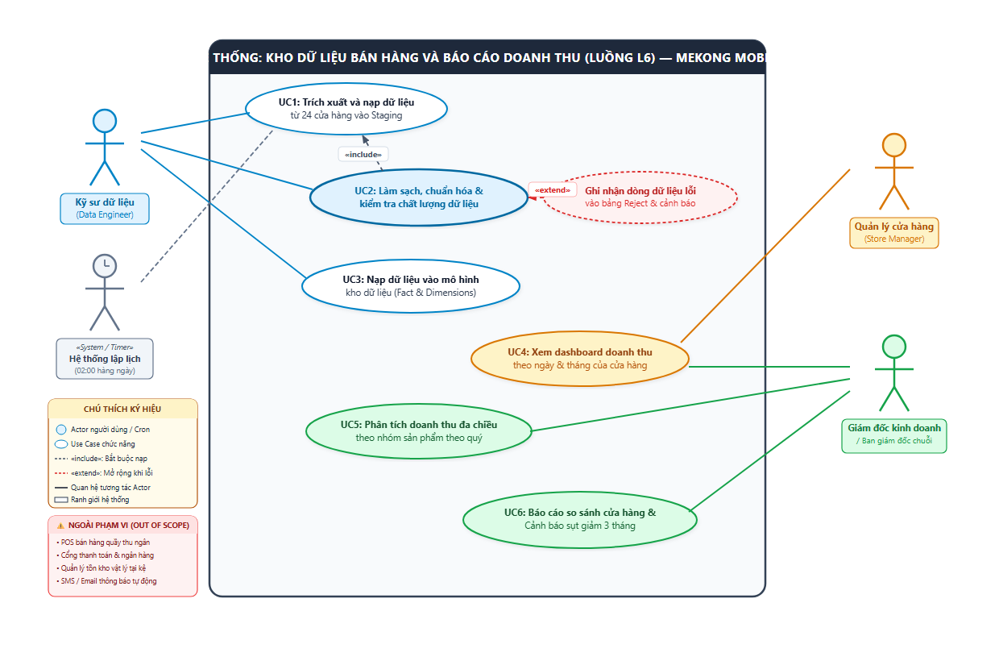

# BÁO CÁO BÀI TẬP 1 (BT1) — HỒ SƠ PHÂN TÍCH YÊU CẦU VÀ THIẾT KẾ KHO DỮ LIỆU
**Học phần:** Chuyên đề tốt nghiệp 1 – Học kỳ 1, Năm học 2026 – 2027  
**Phân hệ / Luồng nghiệp vụ:** Luồng L6 – Kho dữ liệu bán hàng & Báo cáo doanh thu đa chiều  
**Case Study:** Mekong Mobile Smart CRM  
**Sinh viên thực hiện:** Mai Tuấn Kiệt | **MSSV:** 2374802010259 | **Track:** Data Analytics (DA)  
**Giảng viên phụ trách:** TS. Nguyễn Trí Hải / ThS. Nguyễn Minh Tân / ThS. Trần Công Thanh  
**File PDF chính thức đã biên soạn:** [BT1_DA_L6_2374802010259_MaiTuanKiet.pdf](BT1_DA_L6_2374802010259_MaiTuanKiet.pdf)

---

## MỤC LỤC TỔNG HỢP
1. [Phần 1: Giới thiệu tổng quan & Bối cảnh bài toán Luồng L6](#phần-1-giới-thiệu-tổng-quan--bối-cảnh-luồng-l6)
2. [Phần 2: Bảng thuật ngữ chuyên ngành thống nhất (Glossary)](#phần-2-bảng-thuật-ngữ-chuyên-ngành-thống-nhất-glossary)
3. [Phần 3: Bản đặc tả yêu cầu phần mềm rút gọn (SRS 6 mục ISO/IEC/IEEE 29148)](#phần-3-bản-đặc-tả-yêu-cầu-phần-mềm-rút-gọn-srs-6-mục)
4. [Phần 4: Sơ đồ Use Case & Đặc tả chi tiết Use Case (UML)](#phần-4-sơ-đồ-use-case--đặc-tả-chi-tiết-use-case-uml)
5. [Phần 5: Thiết kế Kiến trúc hệ thống & Luồng dữ liệu (Data Flow)](#phần-5-thiết-kế-kiến-trúc-hệ-thống--luồng-dữ-liệu-data-flow)
6. [Phần 6: Mô hình dữ liệu phân tích Dimensional Model (Star Schema)](#phần-6-mô-hình-dữ-liệu-phân-tích-star-schema)
7. [Phần 7: Thiết kế giao diện Dashboard (Wireframe 3 màn hình)](#phần-7-thiết-kế-giao-diện-dashboard-wireframe-3-màn-hình)
8. [Phần 8: Kế hoạch triển khai kỹ thuật cho BT2](#phần-8-kế-hoạch-triển-khai-kỹ-thuật-cho-bt2)
9. [Phần 9: Phụ lục Khai báo sử dụng AI & Cam kết Liêm chính học thuật](#phần-9-phụ-lục-khai-báo-sử-dụng-ai--cam-kết-liêm-chính-học-thuật)

---

## PHẦN 1. GIỚI THIỆU TỔNG QUAN & BỐI CẢNH LUỒNG L6

### 1.1. Bối cảnh bài toán chuỗi bán lẻ Mekong Mobile
Mekong Mobile là chuỗi bán lẻ thiết bị di động và phụ kiện gồm 24 chi nhánh trải rộng tại khu vực Đồng bằng sông Cửu Long. Trong giai đoạn 2024 – 2026, các cửa hàng xuất dữ liệu bán hàng thành các tệp bảng tính độc lập hàng tháng gửi về trụ sở chính. Hiện trạng ghi nhận:
- **Khối lượng dữ liệu:** ~26.000 đơn hàng qua 26 tháng và ~48.000 dòng chi tiết sản phẩm.
- **Vấn đề chất lượng dữ liệu:**
  1. Ngày tháng lẫn lộn 3 định dạng: `dd/mm/yyyy`, `d-m-yy`, `yyyy.mm.dd` (tỷ lệ lỗi ~0.4%).
  2. Có 137 mã đơn hàng bị trùng lặp giữa các chi nhánh do hệ thống tại điểm bán tự phát sinh mã.
  3. Số điện thoại khách hàng lẫn khoảng trắng, dấu chấm, tiền tố quốc tế `84` thay vì `0` (tỷ lệ khuyết thiếu 6.2%).
  4. Chuỗi tiền tệ có 218 dòng bị dính ký tự `"đ"` phía sau số tiền.
  5. Thành tiền chi tiết đơn hàng sai lệch so với tích số `so_luong * don_gia` (cần đối soát sai số $\le 1$ VNĐ).
  6. Tên sản phẩm viết hoa/thường không chuẩn, thừa khoảng trắng.

### 1.2. Mục tiêu hệ thống
- Tự động hóa trích xuất dữ liệu từ 24 chi nhánh vào Staging.
- Làm sạch và chuẩn hóa dữ liệu, cách ly 100% dòng lỗi vào bảng Reject để kiểm toán.
- Mô hình hóa kho dữ liệu đa chiều theo lược đồ Star Schema trên DuckDB/PostgreSQL.
- Xây dựng Dashboard phân tích trực quan bằng Streamlit phục vụ Quản lý cửa hàng và Ban giám đốc chuỗi.

### 1.3. Phạm vi trong và ngoài (MoSCoW)
- **IN-SCOPE (MUST):** ETL nạp 24 file vào Staging; chuẩn hóa ngày ISO, SĐT 10 số, tiền tệ; khử trùng lặp qua bộ khóa `(ma_cua_hang, ma_don)`; nạp bảng Fact và 4 Dimension; Dashboard phân tích doanh thu chi nhánh có che 4 số cuối SĐT (UC4).
- **IN-SCOPE (SHOULD):** Báo cáo so sánh cửa hàng & cảnh báo giảm 3 tháng liên tiếp (UC6); phân tích cơ cấu doanh thu theo nhóm sản phẩm theo quý (UC5).
- **IN-SCOPE (COULD):** Phân tích tỷ lệ khách hàng quay lại mua lần 2 (Repeat Purchase Rate) qua SĐT chuẩn hóa.
- **OUT-OF-SCOPE (WON'T):** Không làm POS tại quầy thu ngân; không quản lý kho vật lý chi tiết; không tích hợp cổng thanh toán trực tuyến/ngân hàng; không gửi SMS/Email thông báo doanh số tự động.

---

## PHẦN 2. BẢNG THUẬT NGỮ CHUYÊN NGÀNH THỐNG NHẤT (GLOSSARY)

| Thuật ngữ tiếng Việt | Thuật ngữ tiếng Anh | Định nghĩa & Ý nghĩa kỹ thuật trong Luồng L6 |
| :--- | :--- | :--- |
| **Đơn hàng** | Order / Sales Order | Một giao dịch mua hàng đã hoàn tất tại một cửa hàng Mekong Mobile. |
| **Chi tiết đơn hàng** | Order Item / Line Item | Một dòng sản phẩm cụ thể nằm trong một đơn hàng. |
| **Cửa hàng / Chi nhánh** | Store / Branch | Một trong 24 điểm bán lẻ vật lý thuộc hệ thống Mekong Mobile. |
| **Khách hàng** | Customer | Người mua hàng, định danh qua số điện thoại 10 chữ số đã chuẩn hóa. |
| **Kho dữ liệu** | Data Warehouse (DWH) | Cơ sở dữ liệu phân tích tổ chức theo mô hình chiều (Star Schema). |
| **Bảng sự kiện** | Fact Table (`fact_sales`) | Bảng chứa các số đo định lượng (doanh thu, số lượng, đơn giá) và khóa ngoại. |
| **Bảng chiều** | Dimension Table (`dim_*`) | Bảng chứa thuộc tính ngữ cảnh (ngày tháng, cửa hàng, sản phẩm, khách hàng). |
| **Mức chi tiết** | Grain | Một dòng Fact đại diện cho một sản phẩm trong một đơn hàng tại một cửa hàng vào một ngày. |
| **Vùng tạm nạp** | Staging Area (`stg_*`) | Nơi lưu dữ liệu thô trung gian phục vụ kiểm toán và xử lý làm sạch. |
| **Vùng dữ liệu lỗi** | Reject Table (`reject_*`) | Nơi cách ly các bản ghi vi phạm chất lượng dữ liệu kèm mã lỗi và timestamp. |
| **Khóa nghiệp vụ** | Business Key | Khóa tự nhiên kết hợp: `(ma_cua_hang, ma_don)` để triệt tiêu trùng mã đơn. |
| **Khóa thay thế** | Surrogate Key | Khóa số nguyên tự sinh (`sales_fact_key`, `store_key`) tối ưu join bảng Fact/Dim. |
| **Che dữ liệu** | Data Masking | Ẩn 4 chữ số cuối của SĐT (`090123****`) trên UI để bảo vệ quyền riêng tư. |
| **Giá trị đơn TB** | Average Order Value (AOV) | Chỉ số đo lường: `Tổng doanh thu / Tổng số đơn`. |

---

## PHẦN 3. BẢN ĐẶC TẢ YÊU CẦU PHẦN MỀM RÚT GỌN (SRS 6 MỤC)

### 3.1. Các bên liên quan và Vai trò người dùng (Stakeholders & Actors)
- **ACT-01 (Kỹ sư dữ liệu - Data Engineer):** Vận hành pipeline ETL, kiểm soát bảng Reject, bảo trì kho DuckDB. Không chỉnh sửa trực tiếp số liệu doanh thu đã chốt; không xem thông tin cá nhân chưa che.
- **ACT-02 (Quản lý cửa hàng - Store Manager):** Xem báo cáo doanh thu theo ngày/tháng của chi nhánh phụ trách. Tuyệt đối không xem dữ liệu của 23 cửa hàng khác.
- **ACT-03 (Ban giám đốc / Giám đốc kinh doanh):** Xem báo cáo tổng hợp 24 chi nhánh; nhận diện cửa hàng suy giảm 3 tháng liên tiếp; phân tích nhóm sản phẩm theo quý. Không chỉnh sửa database nền tảng.
- **ACT-04 (Hệ thống lập lịch tự động - Cron Scheduler):** Kích hoạt tự động pipeline ETL lúc 02:00 sáng hàng ngày (Actor hệ thống).

### 3.2. Yêu cầu chức năng (Functional Requirements - FR)
- **FR1:** Đọc và nạp dữ liệu từ 24 tệp CSV cửa hàng vào Staging không mất mát bản ghi.
- **FR2:** Làm sạch định dạng ngày (ISO-8601), SĐT 10 số, số tiền nguyên VNĐ, chuyển dòng lỗi vào `reject_orders`.
- **FR3:** Khử trùng lặp qua khóa nghiệp vụ kết hợp `(ma_cua_hang, ma_don)` và đối soát thành tiền `|thanh_tien - (so_luong * don_gia)| <= 1 VNĐ`.
- **FR4:** Nạp dữ liệu sạch vào `fact_sales` và 4 Dimension (`dim_date`, `dim_store`, `dim_product`, `dim_customer`).
- **FR5:** Cung cấp Dashboard trực quan lọc doanh thu chi nhánh theo ngày/tháng, hiển thị KPI Cards và che 4 số cuối SĐT.
- **FR6:** Báo cáo so sánh 24 chi nhánh, phát hiện sụt giảm doanh thu 3 tháng liên tiếp và phân tích nhóm sản phẩm theo quý.

### 3.3. Danh sách User Story chuẩn INVEST và Tiêu chí nghiệm thu (AC)
- **US1 (MUST):** Trích xuất dữ liệu vào Staging.
  - *AC1.1 (Luồng chính):* GIVEN 24 file hợp lệ, WHEN pipeline chạy, THEN nạp đủ ~26.000 đơn và ~48.000 dòng chi tiết vào Staging.
  - *AC1.2 (Ngoại lệ file lỗi):* GIVEN 1 file bị lỗi I/O, WHEN xử lý, THEN ghi log lỗi, tiếp tục nạp 23 file còn lại và gửi cảnh báo đỏ cho kỹ sư dữ liệu.
- **US2 (MUST):** Làm sạch và chuẩn hóa dữ liệu.
  - *AC2.1 (Luồng chính ngày):* GIVEN 3 định dạng ngày khác nhau, WHEN parser thực thi, THEN 100% dòng hợp lệ chuyển về `YYYY-MM-DD`.
  - *AC2.2 (Ngoại lệ ngày sai):* GIVEN ngày không có thật hoặc ngày tương lai, WHEN kiểm tra, THEN chuyển dòng vào `reject_orders` với lý do `INVALID_DATE_FORMAT`.
  - *AC2.3 (Ngoại lệ lệch thành tiền):* GIVEN `thanh_tien != so_luong * don_gia` lệch > 1 VNĐ, WHEN đối soát, THEN chuyển dòng vào `reject_order_items` với mã lỗi `INCONSISTENT_TOTAL_AMOUNT`.
- **US3 (MUST):** Xem dashboard doanh thu chi nhánh theo ngày/tháng.
  - *AC3.1 (Luồng chính):* GIVEN quản lý chọn chi nhánh và khoảng ngày, WHEN xem dashboard, THEN render biểu đồ đường và KPI trong dưới 2.5 giây.
  - *AC3.2 (Ngoại lệ không có số liệu):* GIVEN khoảng ngày chưa có đơn hàng, WHEN xem, THEN hiển thị thông báo "Không có giao dịch phát sinh" và chỉ số hiển thị 0 VNĐ.
- **US4 (SHOULD):** Báo cáo so sánh cửa hàng và cảnh báo sụt giảm 3 tháng liên tiếp.
  - *AC4.1 (Luồng chính):* GIVEN ban giám đốc xem báo cáo, WHEN áp dụng lọc tháng, THEN hiển thị xếp hạng 24 cửa hàng và cờ cảnh báo cửa hàng giảm 3 tháng liên tiếp.
  - *AC4.2 (Ngoại lệ kỳ đầu):* GIVEN chọn tháng 1 hoặc 2 năm 2024 (chưa đủ 3 tháng), WHEN tính toán, THEN hiển thị "Chưa đủ dữ liệu kỳ trước".
- **US5 (SHOULD):** Phân tích cơ cấu doanh thu theo nhóm sản phẩm theo quý.
  - *AC5.1 (Luồng chính):* GIVEN chọn quý và năm, WHEN bấm lọc, THEN hiển thị tỷ trọng doanh thu các nhóm thiết bị.
  - *AC5.2 (Ngoại lệ sản phẩm lạ):* GIVEN sản phẩm chưa có trong danh mục chuẩn, WHEN nạp kho, THEN gán vào `product_key = -1` ("Chưa rõ danh mục").
- **US6 (COULD):** Phân tích tỷ lệ khách hàng quay lại mua lần 2 (Repeat Purchase Rate).
  - *AC6.1 (Luồng chính):* GIVEN SĐT đã chuẩn hóa, WHEN truy vấn, THEN hiển thị tỷ lệ khách có từ 2 đơn trở lên trên tổng số khách duy nhất.
  - *AC6.2 (Ngoại lệ SĐT rỗng):* GIVEN đơn hàng khách vãng lai rỗng SĐT, WHEN tính toán, THEN gán vào `customer_key = 0` và loại khỏi mẫu số tính retention.

### 3.4. Yêu cầu phi chức năng có ngưỡng đo lường định lượng (NFR)
- **NFR1 (Hiệu năng):** Toàn bộ pipeline ETL nạp 26.000 dòng hoàn tất trong **dưới 45 giây** (CPU 4 nhân, 8GB RAM). Dashboard Streamlit render biểu đồ trong **dưới 2.5 giây** cho truy vấn 12 tháng.
- **NFR2 (Chất lượng dữ liệu):** Tỷ lệ NULL các trường cốt lõi (`ngay_dat`, `thanh_tien`, `ma_cua_hang`) trong `fact_sales` đạt **bằng đúng 0%**. Tỷ lệ khớp `thanh_tien = so_luong * don_gia` đạt **$\ge 99.5\%$**. Dòng vi phạm cách ly 100% vào bảng Reject.
- **NFR3 (Bảo mật & Quyền riêng tư):** Mọi số điện thoại trên Dashboard phải được **che 4 số cuối** (`090123****`). Phân quyền Quản lý cửa hàng chỉ xem **đúng 01 chi nhánh** phụ trách.
- **NFR4 (Khả chuyển & Dễ triển khai):** Đóng gói trọn gói hệ thống chạy trên Windows, macOS, Linux qua Docker Compose với **đúng 2 câu lệnh**: `docker compose build` và `docker compose up`.

### 3.5. Ràng buộc và Quy tắc nghiệp vụ (QT-01 – QT-05)
- **QT-01:** Khóa nghiệp vụ duy nhất của đơn hàng là cặp kết hợp: `(ma_cua_hang, ma_don)`.
- **QT-02:** Ngày giao dịch bắt buộc quy chuẩn về ISO-8601 (`YYYY-MM-DD`). Từ chối ngày tương lai hoặc trước năm 2020.
- **QT-03:** Thành tiền là số nguyên VNĐ; cho phép sai số làm tròn tối đa 1 VNĐ: `|thanh_tien - (so_luong * don_gia)| <= 1`. Sai lệch lớn hơn phải vào Reject; không suy diễn chiết khấu khi nguồn không có dữ liệu giảm giá tường minh.
- **QT-04:** SĐT khách hàng chuẩn hóa về 10 chữ số (đổi tiền tố `84` thành `0`). Số không hợp lệ gán `is_valid_phone = FALSE` và gán vào `customer_key = 0`.
- **QT-05:** 100% đơn hàng phải có `ma_cua_hang` thuộc danh mục 24 cửa hàng chính thức. Sản phẩm lạ gán `product_key = -1` ("Chưa rõ danh mục").

### 3.6. Bảng truy vết yêu cầu (Requirements Traceability Matrix)
| Mã FR | Yêu cầu chức năng | User Story | Use Case | MoSCoW | Test Case dự kiến (BT3) |
| :---: | :--- | :---: | :---: | :---: | :---: |
| **FR1** | Trích xuất dữ liệu từ 24 tệp cửa hàng vào Staging | US1 | UC1 | MUST | `TC_ETL_01`, `TC_ETL_02` |
| **FR2** | Làm sạch định dạng ngày, SĐT, số tiền, chuyển lỗi vào Reject | US2 | UC2 | MUST | `TC_CLN_01`, `TC_CLN_02`, `TC_CLN_03` |
| **FR3** | Khử trùng lặp khóa nghiệp vụ và đối soát thành tiền | US2 | UC2 | MUST | `TC_VAL_01`, `TC_VAL_02` |
| **FR4** | Nạp dữ liệu vào bảng Fact và các Dimension | US1, US2 | UC3 | MUST | `TC_DWH_01`, `TC_DWH_02` |
| **FR5** | Dashboard doanh thu chi nhánh theo ngày/tháng có che SĐT | US3 | UC4 | MUST | `TC_DSH_01`, `TC_DSH_02` |
| **FR6** | Báo cáo so sánh cửa hàng, cảnh báo giảm 3 tháng & nhóm hàng | US4, US5 | UC5, UC6 | SHOULD | `TC_ANL_01`, `TC_ANL_02`, `TC_ANL_03` |

---

## PHẦN 4. SƠ ĐỒ USE CASE & ĐẶC TẢ CHI TIẾT USE CASE (UML)

### 4.1. Sơ đồ Use Case Diagram

*Sơ đồ bao gồm Ranh giới hệ thống, 4 Actor (Kỹ sư dữ liệu, Cron Scheduler, Quản lý cửa hàng, Ban giám đốc), 6 Use Case, quan hệ `<<include>>` giữa UC2 và UC1, `<<extend>>` giữa UC2 và bảng Reject, Legend và Out-of-Scope.*

### 4.2. Đặc tả chi tiết Use Case UC2: Làm sạch và kiểm tra chất lượng dữ liệu
- **Actor:** Kỹ sư dữ liệu / Cron Scheduler tự động lúc 02:00.
- **Tiền điều kiện:** Pipeline UC1 đã nạp dữ liệu thô vào `stg_orders`, `stg_order_items`. Danh mục `stores.csv`, `products.csv` đã sẵn sàng.
- **Hậu điều kiện:** Dữ liệu sạch chuyển sang kho dữ liệu; 100% dòng lỗi cách ly vào `reject_orders`, `reject_order_items` kèm mã lỗi và timestamp kiểm toán.
- **Luồng chính (Happy Path):**
  1. Đọc lô bản ghi từ `stg_orders`.
  2. Parse ngày về ISO-8601 `YYYY-MM-DD`.
  3. Ghép khóa nghiệp vụ: `ma_cua_hang || '_' || ma_don`.
  4. Chuẩn hóa SĐT 10 số (chuyển đầu số 84 thành 0).
  5. Loại bỏ chữ "đ" và dấu phân cách, cast thành tiền sang số nguyên VNĐ.
  6. Đối soát dòng chi tiết: `|thanh_tien - (so_luong * don_gia)| <= 1`.
  7. Đối chiếu mã cửa hàng với danh mục 24 cửa hàng chính thức.
  8. Ghi dữ liệu sạch sang Ready-to-Load và ghi log kiểm toán.
- **Luồng ngoại lệ (Exceptions):**
  - *2a (Ngày sai):* Chuyển dòng vào `reject_orders` với mã `INVALID_DATE_FORMAT`.
  - *4a (SĐT không chuẩn):* Gán cờ `is_valid_phone = FALSE` và gán `customer_key = 0`, không làm dừng tiến trình tính doanh thu.
  - *6a (Lệch thành tiền > 1 VNĐ):* Chuyển dòng chi tiết vào `reject_order_items` với mã `INCONSISTENT_LINE_TOTAL`.
  - *7a (Mã cửa hàng lạ):* Chuyển vào `reject_orders` với mã `UNKNOWN_STORE_ID`.

### 4.3. Đặc tả chi tiết Use Case UC4: Xem dashboard doanh thu chi nhánh
- **Actor:** Quản lý cửa hàng / Ban giám đốc.
- **Tiền điều kiện:** Người dùng đã đăng nhập; kho dữ liệu đã nạp xong kỳ mới nhất.
- **Hậu điều kiện:** Hiển thị KPI Cards (Doanh thu, Đơn hàng, AOV), biểu đồ đường doanh thu ngày và bảng đơn hàng đã che 4 số cuối SĐT.
- **Luồng chính:** 1. Đăng nhập &rarr; 2. Hệ thống nhận diện chi nhánh phụ trách &rarr; 3. Chọn khoảng ngày &rarr; 4. Bấm Apply &rarr; 5. Gửi SQL truy vấn DuckDB &rarr; 6. Nhận kết quả trong < 2.5s và render giao diện.
- **Luồng ngoại lệ:**
  - *3a (Ngày bắt đầu > kết thúc):* Cảnh báo đỏ và vô hiệu hóa nút Apply.
  - *5a (Không có giao dịch):* Hiển thị "Không có giao dịch phát sinh", chỉ số bằng 0 VNĐ (không crash hoặc NaN).
  - *6a (Mất kết nối database):* Thông báo lỗi kết nối thân thiện.

---

## PHẦN 5. THIẾT KẾ KIẾN TRÚC HỆ THỐNG & LUỒNG DỮ LIỆU (DATA FLOW)

### 5.1. Sơ đồ kiến trúc và luồng dữ liệu L6

### 5.2. Mô tả các phân tầng kiến trúc
1. **Data Source Layer:** 24 file CSV bán lẻ định kỳ và các file danh mục chuẩn (`orders_2024_2026.csv`, `order_items.csv`, `products.csv`, `stores.csv`). Gắn mã cửa hàng vào từng dòng chi tiết để bảo toàn định danh đơn hàng.
2. **Ingestion & Staging Layer:** Cron Scheduler kích hoạt pipeline lúc 02:00. Nạp dữ liệu thô vào `stg_orders` và `stg_order_items` giữ nguyên dữ liệu gốc phục vụ đối soát.
3. **Data Cleaning & Reject Layer:** Cổng kiểm soát chất lượng (Quality Gate) áp dụng regex chuẩn hóa và đối soát. Dữ liệu hợp lệ đi tiếp; dòng vi phạm cách ly vào bảng `reject_orders` và `reject_order_items`.
4. **Data Warehouse Layer:** Lưu trữ kho Star Schema trên DuckDB (hỗ trợ PostgreSQL khi cần mở rộng), gồm 1 bảng Fact (`fact_sales`) và 4 bảng Dimension (`dim_date`, `dim_store`, `dim_product`, `dim_customer`).
5. **Presentation & Dashboard Layer:** Streamlit Dashboard kết nối kho dữ liệu qua Lớp truy cập dữ liệu (Data Access Layer) để thực thi lọc quyền chi nhánh và che 4 số cuối SĐT khách hàng.

### 5.3. Bốn (04) lập luận kiến trúc gắn với NFR và Đánh đổi (Trade-offs)
1. **NFR1 (Hiệu năng ETL < 45s, UI < 2.5s):** Chọn pipeline xử lý theo lô trong một tiến trình (Single-process Batch ETL) kết hợp DuckDB nhúng in-process thay vì tách nhiều microservices. Giảm triệt để độ trễ mạng và chi phí vận hành; đánh đổi là lỗi nghiêm trọng ảnh hưởng cả mẻ chạy &rarr; khắc phục bằng log kiểm toán, bảng reject và chạy lại an toàn (idempotency).
2. **NFR2 (Chất lượng dữ liệu: Null = 0%, Khớp $\ge 99.5\%$):** Thiết kế Cổng kiểm tra chất lượng trước khi nạp Fact với bảng Reject riêng biệt thay vì âm thầm gán giá trị mặc định. Bảo toàn khả năng kiểm toán; đánh đổi là bản ghi lỗi chưa hiển thị ngay trên báo cáo &rarr; khắc phục bằng báo cáo kiểm toán Reject.
3. **NFR3 (Bảo mật: Che 4 số cuối SĐT, phân quyền 1 chi nhánh):** Áp dụng lọc quyền và che SĐT tại Lớp truy cập dữ liệu (Data Access Layer) trước khi trả ra giao diện; tạo trường `phone_masked` riêng. Triệt tiêu nguy cơ rò rỉ dữ liệu cá nhân; đánh đổi là phải quản trị bảng ánh xạ user-store và test kỹ mọi đường truy vấn.
4. **NFR4 (Khả chuyển: 2 lệnh Docker):** Đóng gói toàn bộ ứng dụng, pipeline và kho dữ liệu trong Docker Compose. Dễ dàng dựng môi trường trên mọi hệ điều hành; đánh đổi là DuckDB phù hợp truy vấn phân tích đơn nút &rarr; sẵn sàng cấu trúc DDL để mở rộng sang PostgreSQL.

---

## PHẦN 6. MÔ HÌNH DỮ LIỆU PHÂN TÍCH STAR SCHEMA

### 6.1. Sơ đồ Star Schema

### 6.2. Phát biểu Grain chuẩn Ralph Kimball
> **"Một dòng trong bảng `fact_sales` đại diện cho MỘT MẶT HÀNG (DÒNG CHI TIẾT SẢN PHẨM) trong MỘT ĐƠN HÀNG, được bán tại MỘT CỬA HÀNG vào MỘT NGÀY cụ thể."**

- **Lập luận:** Bắt buộc chọn mức grain chi tiết nhất (Line Item Level) để trả lời câu hỏi nghiệp vụ **CH4** (phân tích nhóm sản phẩm bán chạy theo quý). Nếu tổng hợp grain ở mức đơn hàng (`one row per order`), hệ thống sẽ mất thông tin mặt hàng chi tiết.

### 6.3. Chi tiết Bảng Fact và 4 Bảng Dimension
- **`fact_sales`:** `sales_fact_key BIGINT PK`, `date_key INT FK`, `store_key BIGINT FK`, `product_key BIGINT FK`, `customer_key BIGINT FK`, `order_id VARCHAR(50)`, `order_line_number INT`, `quantity INT`, `unit_price BIGINT`, `line_total BIGINT`, `discount_amount BIGINT`.
- **`dim_date`:** `date_key INT PK` (`YYYYMMDD`), `full_date DATE`, `day_of_month INT`, `month_number INT`, `quarter_number INT`, `year_number INT`.
- **`dim_store`:** `store_key BIGINT PK`, `store_id INT`, `store_code VARCHAR(10)`, `store_name VARCHAR(150)`, `region_name VARCHAR(50)`.
- **`dim_product`:** `product_key BIGINT PK`, `product_id VARCHAR(50)`, `product_name VARCHAR(200)`, `normalized_name VARCHAR(200)`, `category_name VARCHAR(100)`. Có bản ghi dự phòng `product_key = -1` ("Chưa rõ danh mục").
- **`dim_customer`:** `customer_key BIGINT PK`, `normalized_phone VARCHAR(15)` (nhạy cảm), `phone_masked VARCHAR(15)` (`090123****`), `is_valid_phone BOOLEAN`. Có bản ghi dự phòng `customer_key = 0` ("Khách vãng lai").

### 6.4. Câu hỏi phân tích nghiệp vụ CH1 – CH4
- **CH1:** Doanh thu của từng cửa hàng theo từng ngày và từng tháng là bao nhiêu? &rarr; Cửa hàng + Ngày/Tháng (US3).
- **CH2:** Những cửa hàng nào có doanh thu sụt giảm liên tiếp trong 3 tháng gần nhất? &rarr; Cửa hàng + 3 tháng liên tiếp (US4).
- **CH3:** Tỷ lệ khách hàng quay lại mua hàng lần thứ hai (Repeat Purchase Rate) là bao nhiêu? &rarr; Khách hàng + Lịch sử đơn (US6).
- **CH4:** Nhóm danh mục sản phẩm nào đóng góp tỷ trọng doanh thu lớn nhất theo từng quý? &rarr; Nhóm sản phẩm + Quý (US5).

### 6.5. Từ điển dữ liệu nguồn với tỷ lệ thiếu đo đạc thực tế
- `orders_2024_2026.csv`: `Ngay` (Null: 0.4%), `Ma don` (Null: 0.0%), `SDT` (Null: 6.2%), `Thanh tien` (Null: 1.1%, dính chữ "đ"), `Ma cua hang` (Null: 0.0%).
- `order_items.csv`: `ma_don` (Null: 0.0%), `ma_san_pham` (Null: 0.2%), `so_luong` (Null: 0.0%), `thanh_tien` (Null: 0.0%).

### 6.6. Quy tắc chất lượng dữ liệu CL1 – CL5
- **CL1 (Đầy đủ):** NULL của `date_key`, `line_total` trong Fact = **0%**.
- **CL2 (Hợp lệ):** 100% ngày chuyển thành công sang ISO-8601 `YYYY-MM-DD`.
- **CL3 (Duy nhất):** Khóa nghiệp vụ kết hợp `(store_id, order_id)` duy nhất 100%.
- **CL4 (Nhất quán):** `|thanh_tien - (so_luong * don_gia)| <= 1 VNĐ` đạt tỷ lệ **$\ge 99.5\%$**.
- **CL5 (Tham chiếu):** 100% `store_key` trong Fact tồn tại trong `dim_store`.

### 6.7. Bảng quy tắc biến đổi dữ liệu (ETL Transformation Rules)
- Parse 3 format ngày &rarr; ISO-8601, lỗi &rarr; `reject_orders`.
- Ghép `ma_cua_hang || '_' || ma_don` &rarr; Surrogate Key `sales_fact_key`.
- Regex SĐT 10 số, đổi 84 &rarr; 0, che 4 số cuối &rarr; `phone_masked`.
- Regex bỏ chữ "đ" và dấu phân cách &rarr; ép kiểu `BIGINT`.
- Chuẩn hóa tên sản phẩm `lower().strip()`, sản phẩm lạ &rarr; `product_key = -1`.

---

## PHẦN 7. THIẾT KẾ GIAO DIỆN DASHBOARD (WIREFRAME 3 MÀN HÌNH)

### 7.1. Bản vẽ Wireframe tổng hợp 3 màn hình

### 7.2. Đặc tả 3 màn hình Wireframe
1. **Màn hình 1 (Doanh thu chi nhánh theo thời gian - UC4/US3):**
   - Bộ lọc khoảng ngày, chi nhánh phân quyền.
   - KPI Cards: Tổng doanh thu, Số đơn hàng, AOV.
   - Biểu đồ đường doanh thu ngày (`dim_date.full_date` vs. `fact_sales.line_total`).
   - Bảng kê chi tiết giao dịch có mã đơn, thành tiền và SĐT đã che (`phone_masked`).
2. **Màn hình 2 (Cơ cấu doanh thu theo nhóm sản phẩm theo quý - UC5/US5):**
   - Bộ lọc Năm, Quý, Chi nhánh (hoặc toàn chuỗi).
   - Biểu đồ donut/cột tỷ trọng doanh thu nhóm danh mục (`dim_product.category_name`).
   - Bảng xếp hạng Top 10 sản phẩm đạt doanh số cao nhất quý.
3. **Màn hình 3 (So sánh cửa hàng & Cảnh báo giảm 3 tháng liên tiếp - UC6/US4):**
   - Bộ lọc Tháng báo cáo.
   - Hộp cảnh báo đỏ liệt kê chi nhánh sụt giảm 3 tháng liên tiếp: $DoanhThu(N) < DoanhThu(N-1) < DoanhThu(N-2)$.
   - Biểu đồ cột ngang xếp hạng doanh thu 24 chi nhánh và bảng ma trận tăng trưởng MoM.

---

## PHẦN 8. KẾ HOẠCH TRIỂN KHAI KỸ THUẬT CHO BT2

1. **Công nghệ lựa chọn:** DuckDB (database phân tích nhúng), Python 3.10+ (Pandas/Polars cho pipeline ETL), Streamlit (Dashboard trực quan), Docker Compose (đóng gói đa nền tảng).
2. **Cấu trúc pipeline ETL:**
   - `src/extract.py`: Đọc 24 file CSV vào DuckDB staging tables.
   - `src/transform.py`: Làm sạch ngày, SĐT, số tiền, xử lý trùng mã đơn.
   - `src/quality_gate.py`: Kiểm tra quy tắc CL1–CL5, tách dữ liệu sạch sang Ready-to-Load và đẩy dòng lỗi vào Reject.
   - `src/load.py`: Nạp vào Dimension tables và bảng Fact `fact_sales`.
   - `src/app.py`: Ứng dụng Streamlit hiển thị 3 màn hình Dashboard.
3. **Kế hoạch commit chuẩn:** Thực hiện commit thường xuyên theo chuẩn Conventional Commits (`feat:`, `fix:`, `test:`, `docs:`) xuyên suốt quá trình thực hiện BT2 để minh chứng rõ ràng tiến độ học tập.

---

## PHẦN 9. PHỤ LỤC: KHAI BÁO SỬ DỤNG AI & CAM KẾT LIÊM CHÍNH HỌC THUẬT

### 9.1. Bảng kê khai chi tiết các công cụ AI đã sử dụng
| Công cụ AI sử dụng | Dùng vào việc gì cụ thể | Áp dụng ở phần nào của bài tập | Phương pháp kiểm chứng kết quả độc lập |
| :--- | :--- | :--- | :--- |
| **Claude / ChatGPT / Gemini** | Gợi ý cấu trúc câu lệnh kiểm tra chất lượng dữ liệu (Validation Queries) và Regex làm sạch ngày tháng. | Phần 6 (Từ điển dữ liệu, CL1–CL5, ETL Rules) | Chạy thử nghiệm trực tiếp trên Jupyter Notebook với tập dữ liệu mẫu `orders_2024_2026.csv`; tự tay điều chỉnh regex để không bỏ sót SĐT đầu 84. |
| **Draw.io AI Assistant** | Gợi ý bố cục sắp xếp các khối Actor và Use Case để sơ đồ không bị chồng chéo đường nối. | Phần 4 (Sơ đồ Use Case) | Tự tay kiểm tra và vẽ lại ranh giới hệ thống, bổ sung Legend và khung Out-of-Scope theo chuẩn UML. |
| **— Không dùng — (Tự làm 100%)** | Phân tích bài toán nghiệp vụ, phỏng vấn giả định, xây dựng bảng thuật ngữ, xác định 6 User Story, viết 14 tiêu chí Given-When-Then, lập bảng truy vết 100% không ô trống. | Phần 1, 2, 3 (SRS 6 mục đầy đủ) và đặc tả chi tiết Use Case UC2 & UC4 | Tự đọc và bám sát tài liệu case study Mekong Mobile (Bảng 9.1 và dữ liệu 24 cửa hàng); đối chiếu 7 câu hỏi tự kiểm tra của bản SRS tốt. |
| **GitHub Copilot / Antigravity Agent** | Hỗ trợ lập cấu trúc báo cáo, đề xuất cách biểu diễn kiến trúc luồng dữ liệu, grain và wireframe; tổng hợp hồ sơ nhất quán. | Phần 5, 6, 7 (Kiến trúc, Star Schema, Wireframe) | Đối chiếu từng yêu cầu với đề BT1, SRS, Data Requirement; rà soát cấu trúc khóa, kiểu dữ liệu, phép đối soát thành tiền và quy tắc Reject. |

### 9.2. Lời cam kết liêm chính học thuật
> **"Tôi xin cam đoan đã đọc, hiểu rõ và chịu hoàn toàn trách nhiệm cá nhân về toàn bộ nội dung nộp trong hồ sơ báo cáo Bài tập 1 (BT1) này cũng như kho lưu trữ mã nguồn của dự án. Mọi sự hỗ trợ từ công cụ Trí tuệ nhân tạo (AI) đều đã được khai báo minh bạch, trung thực và được sinh viên kiểm chứng, đánh giá độc lập trước khi áp dụng."**

- **Sinh viên thực hiện:** Mai Tuấn Kiệt
- **MSSV:** 2374802010259
- **Ngày hoàn tất và cam kết:** Ngày 05 tháng 11 năm 2026
