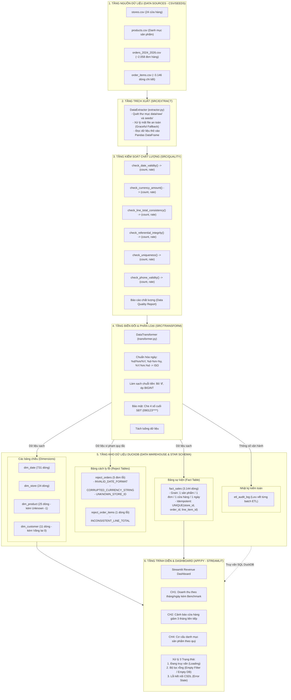

# SƠ ĐỒ KIẾN TRÚC THỰC TẾ ĐÃ HIỆN THỰC (BÀI TẬP 2)
**Học phần:** Chuyên đề tốt nghiệp 1 – Học kỳ 1, Năm học 2026 – 2027  
**Phân hệ / Luồng nghiệp vụ:** Luồng L6 – Kho dữ liệu bán hàng & Báo cáo doanh thu đa chiều  
**Sinh viên thực hiện:** Mai Tuấn Kiệt | **MSSV:** 2374802010259 | **Track:** Data Analytics (DA)  

---

## 1. Sơ đồ Kiến trúc Phân tầng Thực tế (Architecture Layers)

---

## 2. Vị trí các thành phần trong Thư mục Dự án

| Thành phần kiến trúc | Tệp mã nguồn thực tế | Trách nhiệm và Chức năng chính |
| :--- | :--- | :--- |
| **Pha Trích xuất (Extract)** | `src/extract/extractor.py` | Quét và đọc 4 file CSV dữ liệu từ `data/raw/` hoặc `seeds/`. |
| **Pha Kiểm soát chất lượng (Quality)** | `src/quality/checker.py` | 6 hàm kiểm tra chất lượng dữ liệu, mỗi hàm trả về số lượng dòng lỗi và tỷ lệ lỗi (CL1–CL5). |
| **Pha Biến đổi (Transform)** | `src/transform/transformer.py` | Chuẩn hóa ngày ISO, làm sạch tiền tệ, che 4 số cuối SĐT, phân tách bản ghi sạch và bản ghi reject. |
| **Pha Nạp dữ liệu (Load - Idempotent)** | `src/load/loader.py` | Nạp vào DuckDB Star Schema, thực thi chiến lược chống nhân đôi dữ liệu qua bộ ba khóa tự nhiên. |
| **Khởi chạy Pipeline** | `run_pipeline.py` | Điểm khởi chạy 1 lệnh duy nhất cho toàn bộ quá trình ETL và in báo cáo. |
| **Bộ kiểm thử tự động (Test Suite)** | `tests/test_pipeline.py` | 4 test cases (Luồng đúng, Giá trị biên, Dữ liệu sai, Tính Idempotent) chạy bằng `pytest`. |
| **Trình diễn kết quả (Dashboard)** | `app.py` | Dashboard Streamlit xử lý đủ 3 trạng thái (Loading, Empty, Error) và trả lời CH1, CH2, CH4. |
